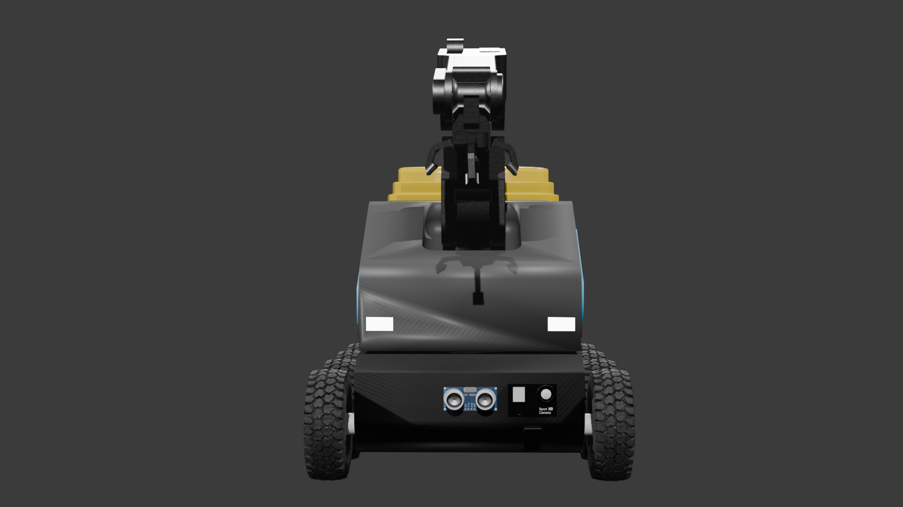
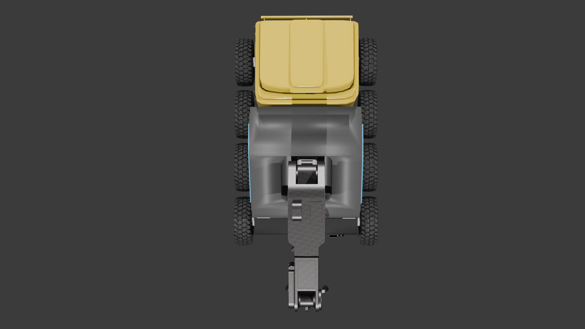
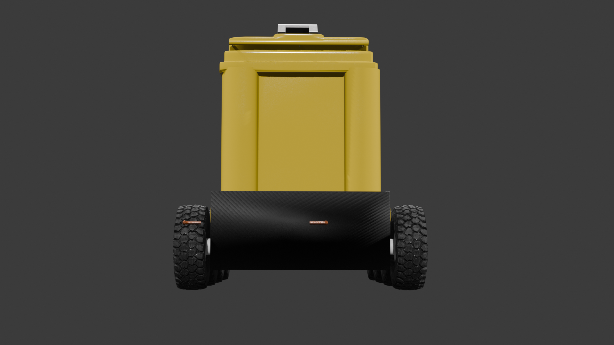
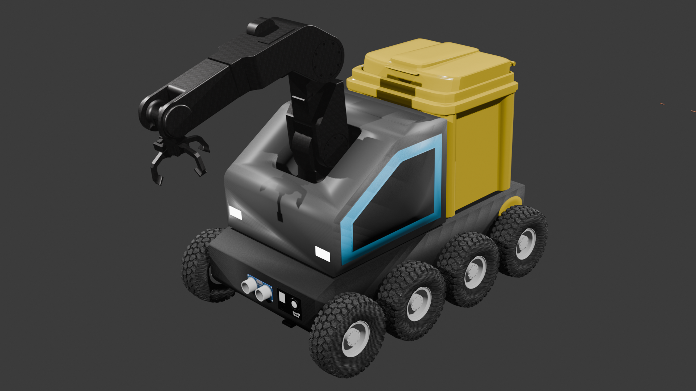

# 🤖 AI-Powered Trash Cleaning Robot
### Intelligent Waste Detection, Collection and Disposal System ♻️

An AI-powered robotics project that combines computer vision, embedded systems, and mechanical design to address waste management challenges.

---

## 🏆 Achievement: National Green Earth Challenge

**West Zone Winner | National Green Earth Challenge**

Our project received recognition as the **West Zone Winner** at the National Green Earth Challenge, highlighting our effort to apply engineering and intelligent automation to an environmental challenge.


---

## 📸 Working Prototype

Our prototype demonstrates the physical design and hardware integration of the AI-powered trash cleaning robot.


---

## 📌 Table of Contents

- [Project Overview](#-project-overview)
- [Problem Statement](#-problem-statement)
- [Proposed Solution](#-proposed-solution)
- [Objectives](#-objectives)
- [Project Gallery](#-project-gallery)
- [System Architecture](#-system-architecture)
- [Technology Stack](#-technology-stack)
- [Hardware Components](#-hardware-components)
- [Software Components](#-software-components)
- [Working Principle](#-working-principle)
- [Project Structure](#-project-structure)
- [Key Features](#-key-features)
- [Challenges and Limitations](#-challenges-and-limitations)
- [Future Scope](#-future-scope)
- [Conclusion](#-conclusion)

---

## 🌍 Project Overview

Waste pollution is a growing environmental concern affecting streets, campuses, residential areas, and public spaces. Traditional waste collection methods often depend on manual labour and continuous human monitoring.

The **AI-Powered Trash Cleaning Robot** explores how Artificial Intelligence (AI), computer vision, robotics, and embedded systems can be combined to improve waste collection.

The system uses a camera to capture images of its surroundings and a YOLOv5-based object detection model to identify waste. A Raspberry Pi 5 handles AI processing, while an Arduino manages low-level hardware control.

The robot is designed to use sensors, motors, and a collection mechanism to support waste detection, movement, pickup, and disposal.

**Project Domain:** Artificial Intelligence, Robotics, Embedded Systems, Environmental Sustainability.

## 🚨 Problem Statement

Improper waste disposal in public spaces creates environmental pollution and unhealthy surroundings. Conventional collection methods face several challenges:

- **Manual effort:** Waste collection requires considerable physical labour.
- **Limited monitoring:** Scattered waste may remain unnoticed across large areas.
- **Time-consuming operations:** Collecting waste from multiple locations can be inefficient.
- **Limited automation:** Conventional methods may not automatically identify and collect scattered waste.
- **Environmental concerns:** Accumulated litter can affect land, water, wildlife, and public health.

### Our Challenge

How can we develop an intelligent and practical robotic system that uses computer vision and embedded hardware to identify waste and assist in its collection with reduced manual intervention?

## 💡 Proposed Solution

We propose an AI-powered trash cleaning robot that integrates computer vision, embedded computing, sensors, and a robotic collection mechanism.

The proposed workflow includes:

1. Capturing environmental images through a camera.
2. Detecting waste using a YOLOv5 object detection model.
3. Processing detections using a Raspberry Pi 5.
4. Controlling movement and actuators through an Arduino.
5. Using ultrasonic sensors to measure nearby obstacles.
6. Operating a robotic collection mechanism to pick up waste.
7. Transferring collected waste to a designated disposal area.

The goal is to demonstrate how intelligent automation can support cleaner and more sustainable environments.

## 🎯 Objectives

- Develop an AI-based waste detection system.
- Integrate computer vision with embedded hardware.
- Design a robotic waste collection mechanism.
- Implement motor and actuator control.
- Support obstacle awareness using distance sensors.
- Explore autonomous waste collection workflows.
- Develop a prototype that can be improved for real-world deployment.

---

## 📸 Project Gallery

### 1. Robot Prototype


### 2. National Green Earth Challenge Achievement


### 3. Project Design



### 4. Robot Model



### 5. Prototype Details



### 6. System Design



### 7. Robot Development


### 8. Hardware and Assembly


### 9. Additional Project View


---

## 🏗️ System Architecture

```text
             ENVIRONMENT
                  |
                  v
             CAMERA MODULE
                  |
                  v
             RASPBERRY PI 5
                  |
                  v
           PYTHON + OPENCV
                  |
                  v
              YOLOv5 MODEL
                  |
                  v
           WASTE DETECTION
                  |
                  v
          CONTROL DECISION LOGIC
                  |
                  v
                ARDUINO
                  |
          +-------+-------+
          |       |       |
          v       v       v
       MOTORS   SERVOS  SENSORS
          |       |       |
          v       v       v
       MOVEMENT  PICKUP  OBSTACLE
                SYSTEM   SENSING
                  |
                  v
          WASTE COLLECTION
                  |
                  v
         DESIGNATED DISPOSAL AREA
```

**Architecture note:** This is the conceptual system architecture. Actual control signals, communication links, and feedback mechanisms should match the implemented hardware and software.

## 🛠️ Technology Stack

| Technology | Application |
|---|---|
| YOLOv5 | Waste object detection |
| Python | AI pipeline and control logic |
| OpenCV | Image processing and camera handling |
| Raspberry Pi 5 | AI computation and system coordination |
| Arduino | Low-level motor and actuator control |
| Ultrasonic Sensors | Distance measurement and obstacle awareness |
| Servo Motors | Robotic collection mechanism |
| Motor Driver | DC motor control |
| GPS Neo-6M | Location information, if integrated |
| Git and GitHub | Version control and project documentation |

## 🔩 Hardware Components

### Raspberry Pi 5
Runs the AI inference pipeline and processes camera data.

### Arduino
Controls motors and actuators according to commands from the control logic.

### Camera Module
Captures images and video frames for waste detection.

### Ultrasonic Sensors
Measure the distance to nearby objects and can support obstacle avoidance.

### Servo Motors
Control the movement of the robotic collection mechanism.

### DC Motors and Motor Driver
Provide locomotion and allow the robot to move according to control commands.

### GPS Neo-6M
Can provide geographical coordinates when location tracking is implemented.

### Battery and Power System
Supplies power to the robot's computing and hardware components.

## 💻 Software Components

### YOLOv5
Identifies waste objects in camera frames and generates bounding boxes, predicted classes, and confidence scores.

### Python
Coordinates the detection pipeline and application-level logic.

### OpenCV
Supports camera access and image processing.

### Arduino Firmware
Handles low-level motor commands and actuator control.

### Control Logic
Coordinates detections, sensor readings, movement, and collection actions.

---

## ⚙️ Working Principle

### Step 1: Environment Monitoring
The camera captures frames from the robot's surroundings.

### Step 2: Waste Detection
The YOLOv5 model processes the images and identifies supported waste categories.

### Step 3: Detection Processing
The Raspberry Pi processes the model output and determines whether a valid detection has occurred.

### Step 4: Movement Control
The control system determines movement commands based on detections and sensor inputs.

### Step 5: Obstacle Sensing
Ultrasonic sensors provide distance measurements to help detect nearby obstacles.

### Step 6: Waste Collection
The robotic mechanism attempts to pick up detected waste using its configured actuator sequence.

### Step 7: Waste Disposal
Collected waste is transferred to the designated disposal area when the required collection and navigation functions are implemented.

### Step 8: Repeat
The robot can repeat the detection and collection process for additional waste items.

---

## 📁 Project Structure

```text
cleaning-robot/
│
├── images/
│   ├── robot-prototype.jpg
│   ├── national-green-earth-challenge.jpg
│   ├── 1untitled.png
│   ├── 2untitled.png
│   ├── 4untitled.png
│   ├── 5untitled.png
│   ├── 10untitled.png
│   ├── 13untitled.png
│   └── 14untitled.png
│
├── design/
│   ├── system-architecture.png
│   ├── circuit-diagram.png
│   └── cad-models/
│
├── src/
│   ├── detection/
│   ├── arduino/
│   └── control/
│
├── docs/
│   ├── TECH_STACK.md
│   ├── working-principle.md
│   └── setup-guide.md
│
├── requirements.txt
├── .gitignore
└── README.md
```

*This is the recommended structure. Add folders and files as the implementation develops. The README and image paths should match the files actually present in the repository.*

## ✨ Key Features

- AI-based waste detection using computer vision.
- Integration of Raspberry Pi computing and Arduino control.
- Sensor-assisted obstacle awareness.
- Motorized robotic movement.
- Servo-based waste collection mechanism.
- Modular hardware and software architecture.
- Potential for location-aware monitoring and future expansion.

Only claim a feature as implemented if it has been developed and tested on the actual robot.

## ⚠️ Challenges and Limitations

- Detecting waste under varying lighting conditions.
- Distinguishing waste from visually similar objects.
- Optimizing inference speed on embedded hardware.
- Coordinating AI decisions with hardware control.
- Avoiding obstacles in crowded environments.
- Handling waste of different sizes and shapes.
- Managing battery life and power consumption.
- Ensuring reliable and safe operation.

## 🚀 Future Scope

### Improved AI Detection
Expand the dataset and improve detection performance across different environments.

### Autonomous Navigation
Integrate navigation algorithms and additional sensors to support independent movement.

### Smart Waste Monitoring
Add a dashboard for viewing detection events and collection statistics if telemetry is available.

### Improved Collection Mechanism
Develop a more reliable gripper or robotic arm for handling different waste types.

### Energy Optimization
Optimize inference, motor operation, and power consumption.

### Multi-Robot Coordination
Explore multiple robots working together to cover larger areas.

### Location-Based Monitoring
Use GPS and mapping capabilities where appropriate to record robot locations and collection activity.

---

## 🌱 Environmental Impact

This project explores the application of intelligent automation to environmental sustainability.

Potential benefits include:

- Reducing repetitive manual waste collection work.
- Encouraging practical AI applications for environmental problems.
- Supporting cleaner campuses and public spaces.
- Establishing a foundation for future smart waste management systems.

The actual impact should be measured through field testing, waste collection efficiency, energy consumption, and operational reliability.

## 📚 Learning Outcomes

Through this project, we explore:

- Artificial Intelligence and Machine Learning.
- Computer Vision and Image Processing.
- Embedded Systems and Microcontrollers.
- Robotics and Motor Control.
- Hardware and Software Integration.
- System Design and Prototyping.
- Git and GitHub for project management.

## 🏁 Conclusion

The AI-Powered Trash Cleaning Robot demonstrates an engineering approach to waste management by combining computer vision, embedded computing, sensors, and robotic actuation.

The project aims to identify waste and support its collection through an integrated hardware and software system. Further improvements in detection accuracy, autonomous navigation, collection reliability, and energy efficiency can help advance the prototype toward practical use.

**Our vision: Intelligent engineering for cleaner and more sustainable environments. 🌍♻️**

---

## 👥 Contributors

**Project Team:** Add the names of all team members and their contributions.

**Institution:** K. K. Wagh Institute of Engineering Education and Research, Nashik, if applicable.

**Achievement:** West Zone Winner, National Green Earth Challenge.

**Project Domain:** AI, Robotics, Embedded Systems, Environmental Sustainability.

## 📄 License

Choose and add an appropriate open-source license before distributing or permitting reuse of the project.
